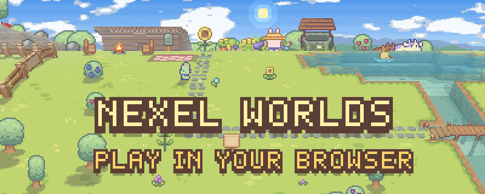
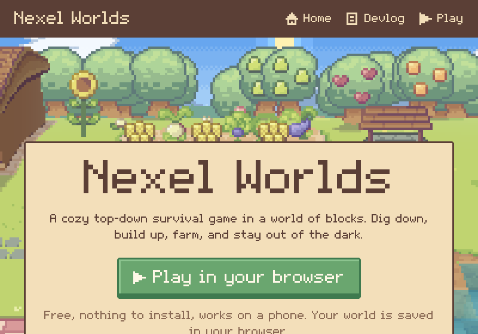
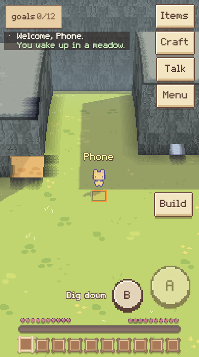
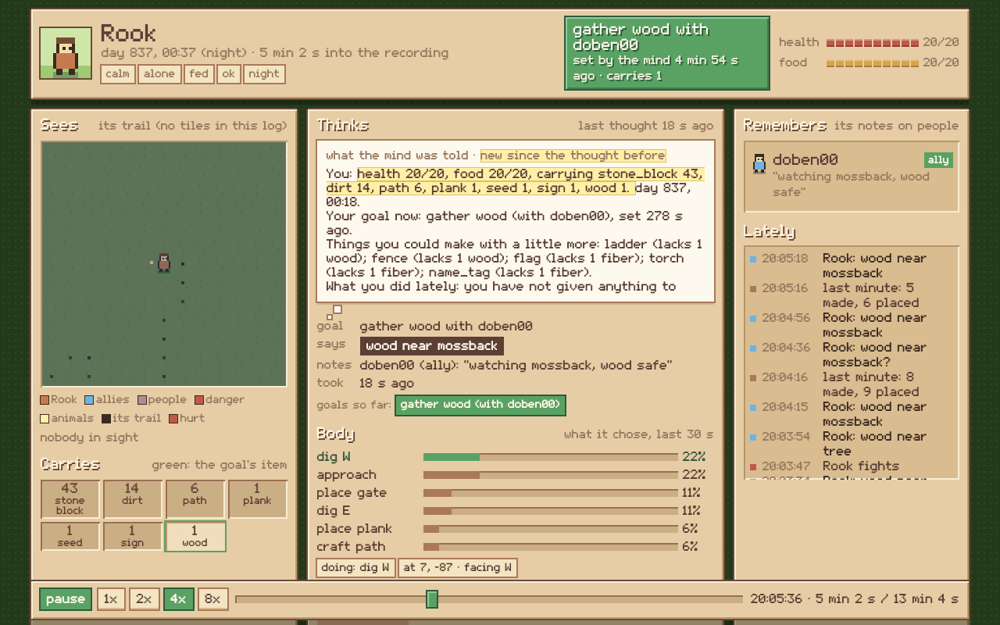
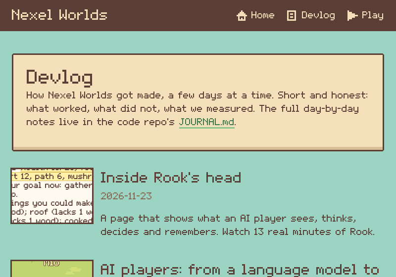

<p align="center">
  
</p>

<p align="center"><b>The home of Nexel Worlds: play the game in your browser, watch an AI player think, read how it is made.</b></p>

<p align="center">
  <a href="https://github.com/sofianedjerbi/nexel-website/actions/workflows/ci.yml"></a>
  <a href="https://sofianedjerbi.github.io/nexel-website/"></a>
</p>

<h3 align="center">
  <a href="https://sofianedjerbi.github.io/nexel-website/play/">Play in your browser</a>
  &nbsp;&middot;&nbsp;
  <a href="https://sofianedjerbi.github.io/nexel-website/play/brain/">Watch an AI player think</a>
  &nbsp;&middot;&nbsp;
  <a href="https://sofianedjerbi.github.io/nexel-website/devlog/">Devlog</a>
</h3>

<br>

<p align="center"><a href="https://sofianedjerbi.github.io/nexel-website/"></a></p>
<p align="center"><i>The landing page: one button, and you are in the game.</i></p>

<p align="center"><a href="https://sofianedjerbi.github.io/nexel-website/play/"></a></p>
<p align="center"><i>The whole game runs in the page, phones included. Your world is saved in your browser.</i></p>

<p align="center"><a href="https://sofianedjerbi.github.io/nexel-website/play/brain/"></a></p>
<p align="center"><i>The brain view: 13 minutes of a real AI player, replayed, with everything it saw and thought.</i></p>

<p align="center"><a href="https://sofianedjerbi.github.io/nexel-website/devlog/"></a></p>
<p align="center"><i>The devlog: how the game got made, a few days at a time.</i></p>

## What you'll find

- The game itself, free, nothing to install: dig, build, farm, fight, and get through the night.
- A world that is yours: it is kept in your browser between visits.
- Touch controls on a phone, keys on a computer.
- A live look inside an AI player's head, from a real recorded game.
- A short, honest devlog: what worked, what did not, what was measured.

<br>

<sub>**Run it yourself.** It is a plain static site:</sub>

```sh
git clone https://github.com/sofianedjerbi/nexel-website && cd nexel-website
python3 -m http.server 8000      # then open http://127.0.0.1:8000
```

<sub>The game's code is in [nexel-worlds](https://github.com/sofianedjerbi/nexel-worlds), the AI players in [nexel-agent](https://github.com/sofianedjerbi/nexel-agent). Rebuilding the pages or the demo: [CONTRIBUTING.md](CONTRIBUTING.md).</sub>

<sub>**Art.** The pictures in the screenshots and in the demo are the Sprout Lands packs by [Cup Nooble](https://cupnooble.itch.io/), used under their licence. The packs may not be redistributed: the site itself uses only screenshots of the game, and the demo ships only the sheets the game uses, as the game does (`play/assets/CREDITS.md`). The pixel font was drawn for Nexel Worlds. The demo's music is made from CC0 instrument recordings (VCSL, VSCO 2 CE by Versilian Studios, FreePats guitar).</sub>

<sub>**Licence.** The Sprout Lands art is Cup Nooble's, under its own licence, and is not covered by any licence of this repository.</sub>
